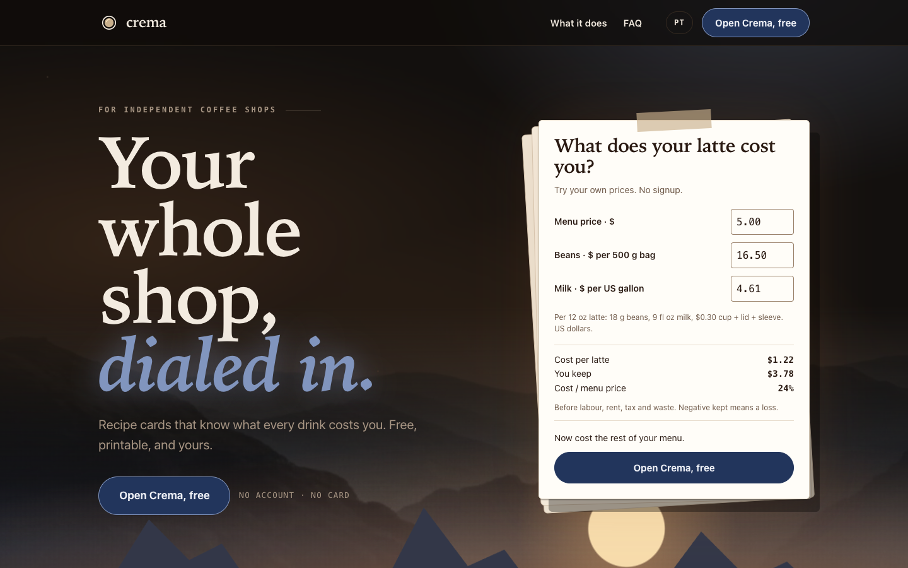
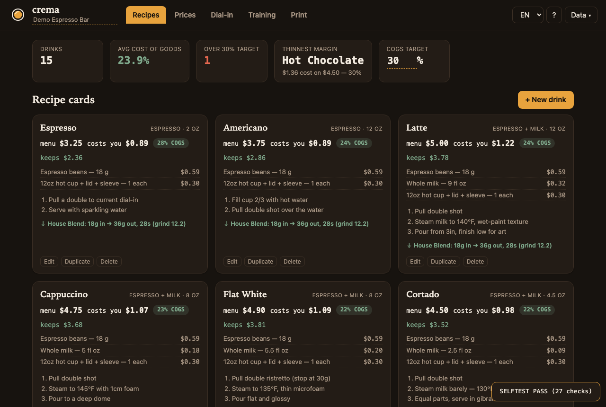
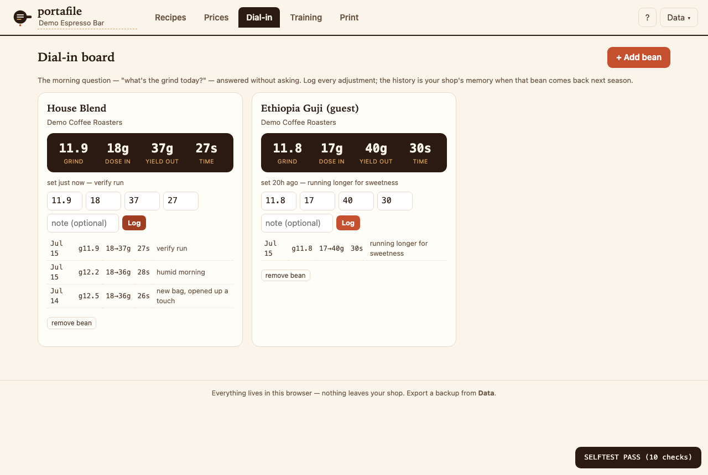

# Crema

**Recipe cards that know what every drink costs. A free tool for independent coffee shops: per-drink cost and margin, espresso dial-in per bean, new-barista training paths, and printable cards. No account. Works offline.**

**Live:** [portafile.vercel.app](https://portafile.vercel.app) · **Try the app:** [/product](https://portafile.vercel.app/product/)

## Why I built it

I'm into specialty coffee, so I started with a question: what actually hurts small coffee shops? I didn't guess. I read real owner and barista threads on Reddit and saved every one I quoted ([`evidence/`](evidence/): 23 saved threads). The strongest pattern: recipes, costs and training live in people's heads. When a barista leaves, the knowledge leaves too, and many owners don't know what a latte costs them to make.

## What it does

| | |
|---|---|
| **Recipe cards with live cost** | Each drink shows menu price, what it costs you, and what you keep. Change the price of milk once and every card updates. |
| **Margin alerts** | Flags any drink over your cost target, and drinks that lose money. |
| **Dial-in per bean** | Grind, dose, yield and time are saved per bean and shown on every card that uses it. |
| **Training path** | Turns the cards into a day-by-day plan for a new barista, with trainer sign-offs. |
| **Print** | Clean recipe cards for the bar. |
| **Two languages** | English and European Portuguese, with euro pricing. |

  
  

## How I built it

**Week one: a two-day sprint from problem to product (July 15-16, 2026).** I wanted to see how far I could get by running [Claude Code](https://claude.com/claude-code) agents through a real startup process, with strict rules I set: every claim must cite a saved source, and nothing ships until it survives a "kill pass". Each step left a written checkpoint:

| Step | File | What happened |
|---|---|---|
| 1 | [`01-hunt-for-pain.md`](01-hunt-for-pain.md) | Found and sourced the pain points |
| 2 | [`02-pick-the-winner.md`](02-pick-the-winner.md) | Picked one, re-scoped it with an adversarial panel |
| 3 | [`03-design-the-business.md`](03-design-the-business.md) | Business model and validation gates |
| 4 | [`04-build-the-brand.md`](04-build-the-brand.md) | Name, palette, logo |
| 5 | [`05-build-the-thing.md`](05-build-the-thing.md) | The app |
| 6 | [`06-launch-video.md`](06-launch-video.md) | A 75-second launch film |
| 7 | [`07-kill-pass.md`](07-kill-pass.md) | Three AI skeptics tried to kill it; every finding fixed and re-checked |

Every decision and why: [`BUILD-LOG.md`](BUILD-LOG.md).

**The next four months: making it real (July to November).** This is where most of my time went:

- **Security.** I audited my own app. I closed a script-injection hole, locked down cloud storage, and built staff links that the owner can revoke for real. Strict security headers and a secret scan run on every push. See [`THREAT-MODEL.md`](THREAT-MODEL.md).
- **Accessibility.** Fixed colour contrast and made the tabs work with the keyboard.
- **Rebrand.** Renamed Portafile → Crema and rebuilt the landing page.
- **Pitching.** I pitched it to café owners, including two in Lisbon, and translated it into European Portuguese with euro pricing for them. No shops use it today.
- **Keeping it healthy.** A daily health check, Dependabot updates, and test suites for the app, the site and the API.

## Tech

Plain HTML, CSS and JavaScript. No framework, no build step. The app keeps data in the browser (localStorage). Optional cloud sync uses Vercel serverless functions + Vercel Blob. Hosted on Vercel. Tests run in Playwright (a tool that drives a real browser). $0 to run.

## Run it

Open `product/index.html` in a browser. That's it: no server, no install, no account. Add `?selftest=1` to the URL to run 27 checks inside the page.

The hosted version asks for an email and shop name once, before first use, so I can see who tried it.

The browser test suites (`verify-*.js`, `product/verify*.js`) use Playwright and are set up for my Mac (see `CLAUDE.md`).

<b>Repo map</b>

| Path | What it is |
|---|---|
| `product/` | The app: `index.html`, `app.js`, `styles.css`, `i18n.js`, screenshots, browser test suites |
| `site/` | The landing page (`site/pt/` = Portuguese) |
| `api/` | Serverless functions: cloud sync, sign-ups, founder metrics |
| `brand/` | Name rationale, palette, logo |
| `evidence/` | The saved Reddit threads behind every quote |
| `extras/` | Launch-post drafts, onboarding emails, a printable dial-in pad |
| `video/` | The launch film |

The lowercase `portafile` in storage keys, API headers and the URL is the old name. It stays, because renaming it would erase existing data.

---

Built by **Ethan Yap** · UC Davis · [LinkedIn](https://www.linkedin.com/in/ethan-yap-827a45346/)
